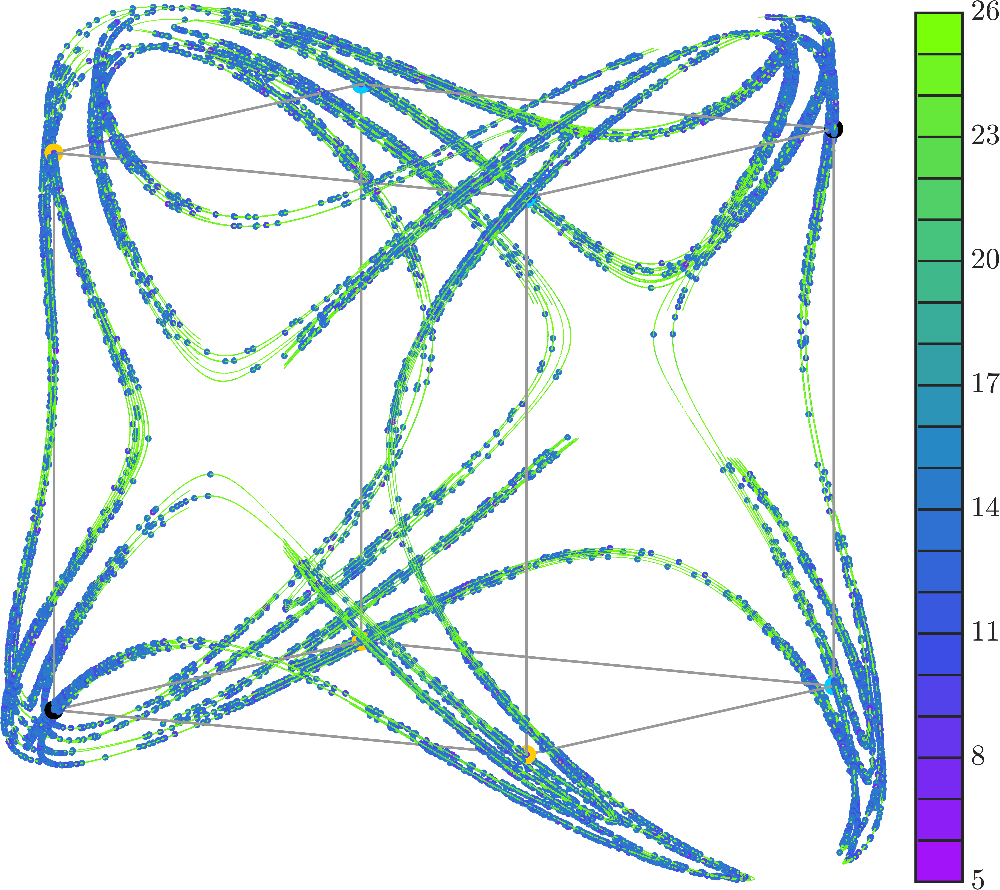

# Periodic Orbit Computation

A numerical implementation for finding periodic orbits in a discrete dynamical system, using **Julia** and **MATLAB**.

## Overview

This project implements a numerical method for finding periodic orbits of the three-dimensional discrete dynamical system

$$
T(x,y,z) = \left(z+k(x^2+y^2-2),\ x,\ y\right),
$$

where \(k = \sqrt{20}\).

A periodic orbit is a finite sequence of points that returns to its starting point under repeated application of the map. More precisely, a point \(\mathbf{x}\) is periodic with period \(n\) if

\[
T^n(\mathbf{x}) = \mathbf{x},
\]

where \(T^n\) denotes \(n\) successive applications of \(T\). The smallest such positive integer \(n\) is called the *minimal period*.

Finding periodic orbits numerically can be challenging, particularly for higher periods, where conventional approaches based on Newton's method require increasingly accurate initial guesses.

This project implements an alternative approach that solves for all points in a periodic orbit simultaneously, reducing the problem to a system of nonlinear equations whose dimension depends only on the orbit period.

The method exploits the symmetries of the resulting algebraic system to reduce the number of initial guesses required. In particular, the Fredricksen–Kessler–Maiorana (FKM) Necklace algorithm generates representative binary sequences, accounting for equivalence under cyclic permutation.

The computation is implemented in Julia, using the `NLsolve.jl` package. MATLAB is used for post-processing and visualisation of the computed orbits.

The following figure illustrates periodic orbits computed using the
numerical method.



## Numerical Method

The computation proceeds in three main stages:

1. **Seed generation:** The Necklace algorithm generates representative binary sequences from \(\{-1,1\}^n\), eliminating sequences that are equivalent under cyclic permutation.
2. **Numerical solution:** Each seed is used as an initial guess for Newton's method, which solves an \(n\)-dimensional nonlinear system to find a periodic orbit.
3. **Post-processing:** Solutions corresponding to lower-period orbits and cyclically equivalent representations are identified and removed, leaving the distinct orbits of interest.

By exploiting the structure and symmetries of the dynamical system, this approach avoids the need for an exhaustive search over phase space.

## Performance

The numerical method significantly reduces the computational effort required to find periodic orbits. Previous work reported finding 1,329 period-11 points using an exhaustive search over phase space, a computation that took approximately three days.

In comparison, the method implemented here finds 1,364 period-11 points in 0.0945 seconds on a desktop computer.

The following table summarises the computational results for periods \(5 \leq n \leq 26\).

| Period \(n\) | Periodic points | Periodic orbits | Computation time (s) |
|:---:|---:|---:|---:|
| 5 | 30 | 6 | 0.0939 |
| 6 | 24 | 4 | 0.0923 |
| 7 | 126 | 18 | 0.0933 |
| 8 | 64 | 8 | 0.0882 |
| 9 | 450 | 50 | 0.0892 |
| 10 | 280 | 28 | 0.0953 |
| 11 | 1,364 | 124 | 0.0945 |
| 12 | 936 | 78 | 0.1294 |
| 13 | 4,498 | 346 | 0.1752 |
| 14 | 3,948 | 282 | 0.1794 |
| 15 | 15,510 | 1,034 | 0.2297 |
| 16 | 13,696 | 856 | 0.4102 |
| 17 | 51,544 | 3,032 | 0.7298 |
| 18 | 47,088 | 2,616 | 1.2866 |
| 19 | 163,020 | 8,580 | 2.4500 |
| 20 | 159,920 | 7,996 | 4.7658 |
| 21 | 534,870 | 25,470 | 10.3682 |
| 22 | 583,924 | 26,542 | 20.5057 |
| 23 | 1,806,328 | 78,536 | 44.7350 |
| 24 | 1,984,080 | 82,670 | 89.3406 |
| 25 | 5,977,350 | 239,094 | 203.7565 |
| 26 | 6,693,804 | 257,454 | 423.1983 |

*Computation times are from the original research implementation and are hardware-dependent.*

## Technologies

- **Julia** – Numerical algorithm implementation and computation.
- **NLsolve.jl** – Nonlinear equation solving using Newton's method.
- **MATLAB** – Post-processing, data analysis and visualisation.

## Project Structure

```text
periodic-orbit-computation/
├── julia/
│   ├── main.jl
│   └── compute_orbits.jl
├── matlab/
│   └── process_orbit_data.m
├── data/
└── README.md
```

## Running the Project

### Instructions

1. Clone the repository.
2. Install the required Julia packages.
3. Ensure the MATLAB executable path in the main Julia script is configured for your installation.
4. Run the main Julia script. Computation time depends on the range of periods and your machine's specifications; a full run may take up to approximately 30 minutes.

The script computes periodic orbits over a specified range of periods, saves the results, and invokes MATLAB for post-processing and visualisation.

## Research Background

This project is based on numerical methods developed as part of my PhD research in computational dynamical systems at the University of Auckland. The results presented here contributed to the following research, which is currently under review:

Doak, S., Krauskopf, B. and Osinga, H. M. (2026). [Characterising the maximal invariant set of a map with (robust) heterodimensional cycles](https://www.math.auckland.ac.nz/~hinke/preprints/dko_hetdim.html). University of Auckland, September 2026.